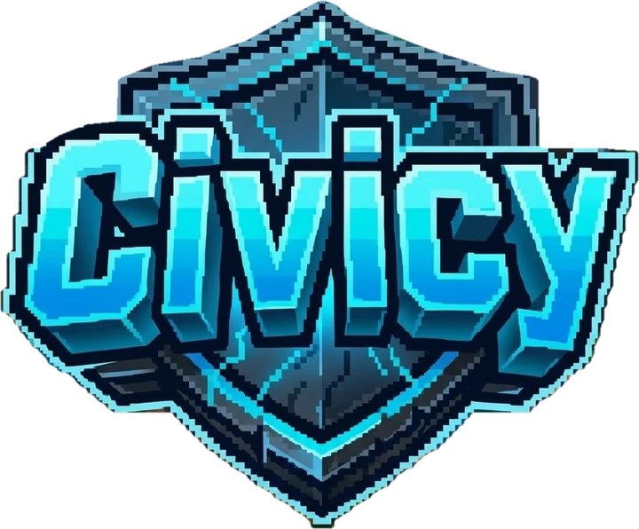

<p align="center"></p>

# Civicy

Die Webseite zum Minecraft-Server **Civicy**: Neuigkeiten, Regeln, Ränge, Team und Karriere – und eine eigene Anmeldung mit dem Microsoft-Konto, die Skin, Namen und Rang des Spielers zeigt.

Die Seite ist reines HTML, CSS und JavaScript. Es gibt keinen Build-Schritt, sie läuft direkt auf GitHub Pages oder jedem anderen Webserver. Aufgebaut wie die Train-Sim-Germany-Seite, nur ohne Netz, Spielersuche und Server-Liste – dafür mit allem, was ein Minecraft-Server braucht.

## Seiten

| Seite | Adresse | Inhalt |
|---|---|---|
| **Start** | `#/` | Nachthimmel mit Polarlicht, Sternen und Hügeln aus Blöcken; IP zum Kopieren, Discord, Live-Status (Spieler online, Version), Mondturm als Bild. Darunter „So startest du“ in drei Schritten, Merkmale als Inventar-Felder, Sätze aus dem Team mit Ring, Neuigkeiten, Zahlen, häufige Fragen und „Werde Teil des Teams“ |
| **Neuigkeiten** | `#/news`, `#/news/<id>` | Filter nach Kategorie, neueste groß, Rest als Karten mit Lesezeit. Jede Neuigkeit als eigene Seite mit Titelbild (Mondturm oder eine Nachtlandschaft in der Farbe der Kategorie), Text und Teilen |
| **Regeln** | `#/regeln` | Durchnummerierte Paragraphen in Gruppen (Miteinander, Fair spielen, Bauen & Städte, Handel & PvP) |
| **Ränge** | `#/raenge` | Spielränge von Neuling bis Legende mit Vorteilen, dazu Team- und Sonderränge. Angemeldet ist der eigene Rang markiert |
| **Team** | `#/team`, `#/team/<Name>` | Teammitglieder mit 3D-Skin nach Bereich; ein Klick baut den Bildschirm mit Blöcken zu und öffnet den Steckbrief |
| **Karriere** | `#/karriere`, `#/karriere/<id>` | Offene Stellen nach Bereich, jede mit Aufgaben, Anforderungen und Bewerbung in drei Schritten (`…/bewerben`, nur angemeldet) |
| **FAQ** | `#/faq` | Alle Fragen zum Aufklappen, Link zum Discord |
| **Mein Konto** | `#/konto` | Skin, Name, Rang, UUID, Microsoft-Konto, „Dein Weg“ durch die Ränge, eigene Bewerbungen, Farbschema, Abmelden |
| **Rechtliches** | `impressum.html`, `privacy.html`, `terms.html` | Angaben kommen aus `config.js` (`legal`) |

Oben schwebt die Leiste mit dem Logo (nur Schild und Schriftzug), den wichtigsten Seiten, der IP zum Kopieren, dem Kopf des angemeldeten Spielers und dem Menü (Seiten, IP, Discord, Hell/Dunkel/Auto). Standard ist das dunkle Theme, Hauptfarbe das leuchtende Hellblau `#5CE1FF`.

## Anmeldung

Ein Klick auf das Profil öffnet die **eigene Anmelde-Oberfläche**:

1. **E-Mail** eingeben (oder „Konto bei Microsoft auswählen“)
2. **Fast geschafft** – kurze Erklärung, dann geht es zu Microsoft. Die E-Mail wird mitgegeben, Microsoft fragt also direkt nach Passwort bzw. Bestätigung in der Authenticator-App
3. Zurück auf der Seite: **Microsoft → Xbox Live → Minecraft-Profil → Rang** wird Schritt für Schritt abgehakt
4. **Willkommen** mit Skin, Namen und Rang – oben in der Leiste erscheint der Kopf des Spielers

Das Passwort wird nur bei Microsoft eingegeben, nie auf der Webseite. Das ist bei Microsoft-Konten auch gar nicht anders möglich.

**Demo-Modus:** Solange `microsoft.clientId` oder `api` in `assets/js/config.js` leer ist, läuft dieselbe Oberfläche, fragt nach der E-Mail aber nur den Minecraft-Namen ab und lädt dazu den Skin. Der Rang kommt dann aus der Team-Liste in `data.js`.

Für die echte Anmeldung: **[backend/README.md](backend/README.md)** (Azure-App registrieren, Minecraft-Zugang bei Mojang beantragen, Backend per GitHub Actions veröffentlichen).

## Anpassen

| Datei | Was |
|---|---|
| `assets/js/config.js` | Server-IP, Bedrock, Version, Live-Status, Microsoft-Client-ID, Backend-Adresse, Links (Discord, YouTube, TikTok …), Angaben fürs Impressum |
| `assets/js/data.js` | Ränge, Team, Sätze aus dem Team, Merkmale, Neuigkeiten, Regeln, FAQ, Stellen und Bewerbungsfragen – alles Beispiel-Inhalt |
| `assets/css/style.css` | Farben ganz oben (`--brand` usw.) |
| `assets/img/` | `logo.webp` (Schild mit Schriftzug, freigestellt), `logo-sm.webp`, `mondturm.jpg` |

Köpfe und Skins kommen von mc-heads.net, der Live-Status von api.mcsrvstat.us.

## Lokal starten

```bash
python3 -m http.server 8000
# → http://localhost:8000/
```

## Veröffentlichen

GitHub Pages: **Settings → Pages → Deploy from a branch → main / (root)**. Die Seite liegt dann unter `https://loris6.github.io/Civicy/`.

---

Civicy ist kein offizielles Minecraft-Produkt und nicht von Mojang oder Microsoft genehmigt oder mit ihnen verbunden. Symbole: [Phosphor Icons](https://phosphoricons.com) (MIT) und [Simple Icons](https://simpleicons.org) (CC0). Schriften: Rubik und Silkscreen (SIL Open Font License).
